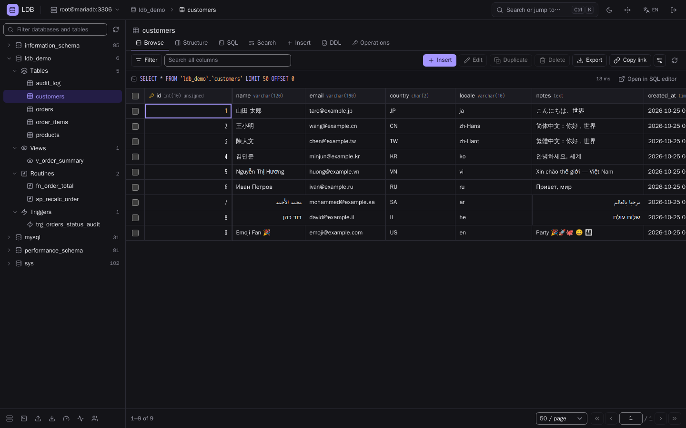
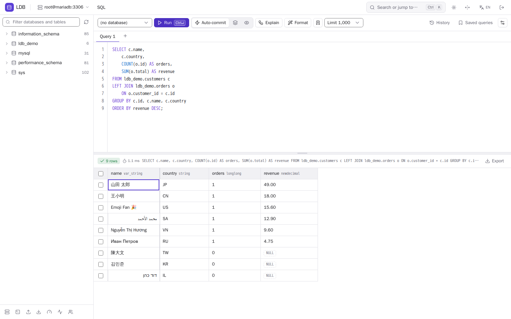
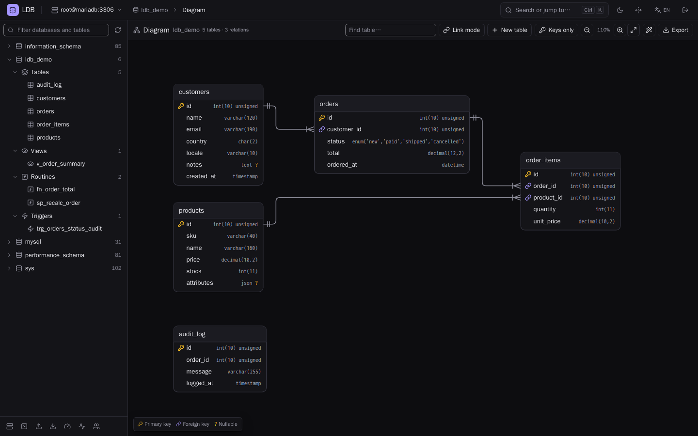
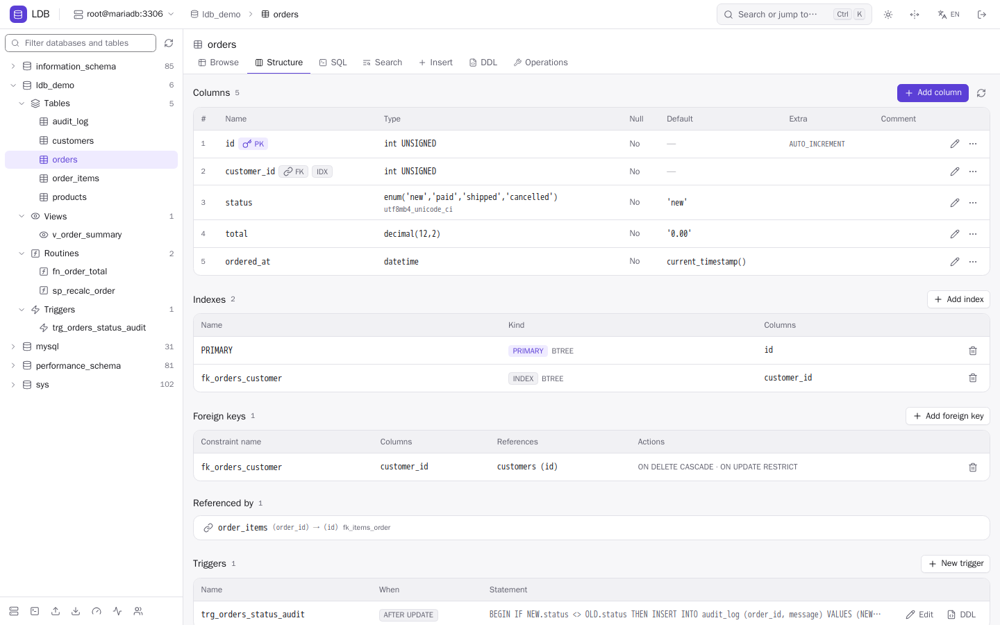
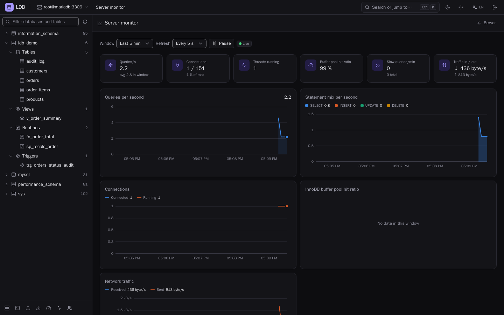
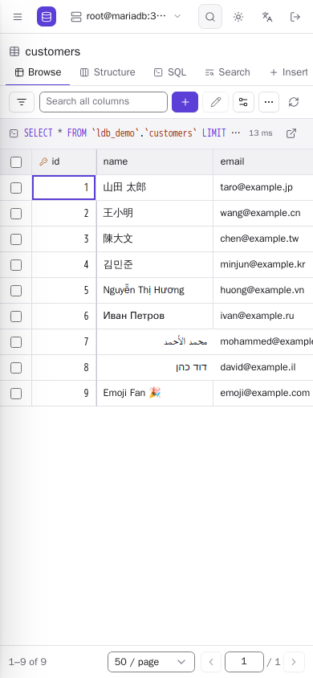

# LDB

**A modern, web-based database administration tool and a replacement for phpMyAdmin.**

[](https://github.com/Pluxx/ldb/actions/workflows/ci.yml) [](https://github.com/Pluxx/ldb/releases/latest) [](LICENSE) [](#requirements) [](#highlights)

LDB works with **MySQL / MariaDB / Percona**, **PostgreSQL**, **SQLite** and **Microsoft SQL Server** (phpMyAdmin supports
only MySQL and MariaDB). The backend is plain PHP without runtime Composer dependencies, and the frontend is prebuilt, so
you install it by unzipping it on any PHP server. The full user manual is available here: [docs/MANUAL.md](docs/MANUAL.md)



> **Status: beta (0.1).** LDB is still young. It is tested with unit, integration and browser tests on
> PHP 7.4 to 8.4 against real MariaDB, MySQL, PostgreSQL, SQLite and SQL Server. However, it has not yet
> had an external security audit, and the translations have not yet been reviewed by native speakers. Please try it on
> non-critical servers first, preferably with read-only connections, and please report any issues you find.

## Why LDB?

I was tired of phpMyAdmin's worn-out interface. It still does its job, but it looks and feels like it
did fifteen years ago: the pages are cluttered, every action reloads the page, there is no dark mode, it is
inconvenient on a phone, and it only works with MySQL. LDB is my idea of what a database tool in the browser
should look like today: clean, fast, usable with the keyboard and on mobile devices, and compatible with the
databases I actually use. At the same time, I wanted it to be as easy to install as phpMyAdmin: you unzip it
on any PHP server and start working.

## Highlights

Features that a driver cannot support are hidden automatically. See the [changelog](CHANGELOG.md) for the complete list.

**Databases**
- MySQL / MariaDB / Percona, PostgreSQL, SQLite and SQL Server in one interface, with several simultaneous connections
- Database settings: charset and collation (with optional table conversion), copy, rename, drop, and engine specific options

**Editing**
- Data grid with sorting, filter builder, search, pagination, foreign-key dropdowns and links
- Inline edits, inserts and deletes are collected in a batch, reviewed as SQL and applied in one transaction

**SQL editor**
- Syntax highlighting, dialect-aware autocomplete and formatter, multiple statements and result sets, `EXPLAIN`
- History, saved queries, share links, a **Stop** button, *Atomic* and *Dry run* transaction modes, and confirmation for risky SQL

**Structure and schema**
- Create and alter tables with an SQL preview, table operations, DDL view, editor for routines, events and triggers
- Editable ER diagram, whole-database search, and a schema diff that produces reviewed migration scripts

**Import and export**
- Import: SQL and CSV (many encodings), plain or compressed (gzip, bzip2, zip), streamed
- Export: SQL, CSV, JSON, XML, Markdown and Excel XML, with gzip or zip compression, streamed

**Administration**
- Variables, status, processes, live server monitor with charts, top and slow queries and tuning hints
- Users with a privileges editor (global, database, table and column level, roles, limits)

**Security**
- Credentials encrypted in the session, CSRF protection, strict CSP, login rate limiting, server-side read-only connections
- Optional two-factor authentication (TOTP and recovery codes) and single sign-on links for control panels

**Usability and languages**
- Command palette (Ctrl/Cmd+K), keyboard shortcuts, light, dark or system theme, mobile friendly layout, no CDN (works offline)
- 20 languages: English, Deutsch, Español, Français, Italiano, Português (Brasil), Polski, Türkçe, Русский, العربية, עברית, اردو, हिन्दी, বাংলা, Bahasa Indonesia, Tiếng Việt, 日本語, 한국어, 简体中文 and 繁體中文 (right-to-left layout for Arabic, Hebrew and Urdu)

## Screenshots

<table>
  <tr>
    <td width="50%"><a href="docs/screenshots/sql-light.png"></a><br><sub>SQL editor with formatted query and results (light theme)</sub></td>
    <td width="50%"><a href="docs/screenshots/erd-dark.png"></a><br><sub>ER diagram with foreign-key relations (dark theme)</sub></td>
  </tr>
  <tr>
    <td width="50%"><a href="docs/screenshots/structure-light.png"></a><br><sub>Table structure (light theme)</sub></td>
    <td width="50%"><a href="docs/screenshots/monitor-dark.png"></a><br><sub>Server monitor with live charts (dark theme)</sub></td>
  </tr>
  <tr>
    <td colspan="2" align="center"><a href="docs/screenshots/mobile-light.png"></a><br><sub>Browsing a table on a phone (390 px wide)</sub></td>
  </tr>
</table>

## Quick start

1. Download `ldb-<version>.zip` from the [latest release](https://github.com/Pluxx/ldb/releases/latest) and verify it against `SHA256SUMS`.
2. Unzip it into your web root (for example `https://example.com/ldb/`). Please point the virtual host's `DocumentRoot` at the `public/` directory (recommended),
   or rely on the root `.htaccess`, which serves `public/` and denies access to internal files (this needs `mod_rewrite`).
3. Optional: copy `config/config.sample.php` to `config/config.php` and adjust it (see [Configuration](#configuration)).
4. Open the URL in your browser and log in with the credentials of your database account.

The archive contains the built frontend and requires neither Composer nor Node.js.

### Try it with Docker

```sh
git clone https://github.com/Pluxx/ldb.git
cd ldb
docker compose up -d --build --wait
```

Then open <http://localhost:8080> and log in with the preset **MariaDB 11 (docker)** (`root` / `root`). The stack also contains MySQL 8.0
(`root` / `root`) and PostgreSQL 17 (`postgres` / `postgres`). Each of them has the multilingual demo database `ldb_demo`.
Run `docker compose down` to stop it. See [Docker development stack](#d-docker-development-stack) for details.

## Requirements

- PHP 7.4 or newer (it also runs on 8.x) with `pdo`, `json`, `openssl`, `mbstring`
- The PDO driver for each engine you want to use: `pdo_mysql`, `pdo_pgsql`, `pdo_sqlite`,
  `pdo_sqlsrv` or `pdo_dblib` (SQL Server)
- Optional extensions: `zlib` (gzip import/export), `zip` (zip import/export), `bz2` (bzip2 import), `iconv` (CSV import in non-UTF-8 encodings)
- A web server (Apache, nginx + PHP-FPM, and so on). **Node.js is not needed to run LDB**, because the built assets are committed in `public/assets/dist/`.

### Supported database versions

LDB supports every database version released in 2018 or later:

| Engine | Fully supported from | Released | Tested against |
|---|---|---|---|
| MySQL (and Percona Server) | 8.0.11 | April 2018 | 8.0.11 and the latest 8.0 |
| MariaDB | 10.3 | May 2018 | 10.3 and 11 |
| PostgreSQL | 11 | October 2018 | 11 and 17 |
| Microsoft SQL Server | 2019 (15.x) | November 2019 | 2019 and 2022 |
| SQLite | 3.22 | January 2018 | the library bundled with PHP; older versions are simulated in unit tests |

Features that are newer than the minimum are used only when the server has them, for example
`EXPLAIN ANALYZE` (MySQL 8.0.18), generated columns (PostgreSQL 12) or `STRICT` tables (SQLite 3.37).
Otherwise LDB hides the option or uses a fallback, such as the table rebuild on SQLite before 3.25.
Older servers can still be used, but they are not tested: LDB shows a warning banner ("This server version
is older than LDB supports. Some features may not work."), which you can dismiss per server.

## Installation

### Download a release (easiest)

Please download `ldb-<version>.zip` (or `.tar.gz`) from the [GitHub Releases](https://github.com/Pluxx/ldb/releases) page, verify it against
`SHA256SUMS`, and unzip it into your web root (for example `https://example.com/ldb/`). You can either point the virtual
host's `DocumentRoot` at the `public/` directory (recommended) or rely on the root `.htaccess`, which serves `public/`
and denies access to internal files (this needs `mod_rewrite`). The archive contains the built frontend and requires neither Composer nor Node.js.

### a) Drop-in (any PHP web host)

Copy or clone the repository into the web root, for example `https://example.com/ldb/`. The root
`.htaccess` serves `public/` and denies access to `src/`, `config/`, `vendor/` and other internal files (this needs `mod_rewrite`).

**Recommended:** Please point the virtual host's `DocumentRoot` at the `public/` directory instead. Then nothing else is reachable at all.

### b) From git

```sh
git clone https://github.com/Pluxx/ldb.git ldb
cd ldb
composer install --no-dev   # optional
```

Running `composer install` is optional. If `vendor/` is missing, `src/autoload.php` provides a PSR-4 fallback. LDB is not published as a Composer package.

### c) nginx + PHP-FPM

Please see [`docs/nginx.conf.example`](docs/nginx.conf.example). The document root is `public/`, and only `index.php`, `api.php` and `sso.php` are executed.
`client_max_body_size` should match `upload_max`, buffering is switched off for streaming exports, and `HTTPS on` is passed to PHP.

### d) Docker development stack

```sh
docker compose up -d --build --wait
```

Then open <http://localhost:8080>. The stack runs the app (PHP 7.4 by default; use `PHP_VERSION=8.3 docker compose up -d --build` for another version),
MariaDB 11, MySQL 8.0 and PostgreSQL 17 with a multilingual demo database `ldb_demo`. The presets are defined in
`config/config.docker.php` (mounted as `config/config.php` in the container):

| Preset | Server | User / password |
|---|---|---|
| `mariadb` | MariaDB 11 | `root` / `root` |
| `mysql` | MySQL 8.0 | `root` / `root` |
| `pgsql` | PostgreSQL 17 | `postgres` / `postgres` |
| `mssql` | SQL Server 2022 (profile `mssql`, see below) | `sa` / `Ldb_Passw0rd!` |
| SQLite | files in `/var/www/data` | any file name below it; the SQLite password is `sqlite` (dev only) |

The default image has no SQL Server driver, to keep it small. Please see [SQL Server](#sql-server) for the `mssql` profile.
`docker compose down` stops the stack. The volumes keep the data.

### Upgrading

1. Keep `config/config.php` (and your `data_dir`, if you use two-factor authentication).
2. Unpack the new release next to the old one, or over it. If you unpack over the old installation, please delete `public/assets/dist/` first,
   because the frontend files carry content hashes in their names and old files would otherwise stay behind.
3. Compare your `config/config.php` with the new `config/config.sample.php` for new options. Missing options use their defaults.

Query history, saved queries and UI preferences are stored in the browser, so an upgrade does not affect them.
See the [manual](docs/MANUAL.md#27-upgrading) for the details.

### SQL Server

LDB supports SQL Server 2016 and newer through **`pdo_sqlsrv`** (preferred; needs the Microsoft ODBC Driver 17/18 for SQL Server)
or **`pdo_dblib`** (FreeTDS, fallback; select it with the preset/connection option `pdo_driver: dblib`).

- Debian/Ubuntu: install `msodbcsql18` from `packages.microsoft.com` (`https://packages.microsoft.com/config/<distro>/<version>/packages-microsoft-prod.deb`,
  `ACCEPT_EULA=Y apt-get install msodbcsql18 unixodbc-dev`), then `pecl install sqlsrv pdo_sqlsrv` and enable both extensions
  (`pdo_sqlsrv` 5.10.x for PHP 7.4/8.0, 5.12+/5.13 for PHP 8.1+). With ODBC Driver 18, encryption is on by default. LDB sets
  `TrustServerCertificate=1` unless the connection option `trust_server_certificate` is false.
- Windows: use the DLLs of the Microsoft Drivers for PHP for SQL Server.
- Docker dev stack: the SQL Server instance and a one-shot seed job are part of the `mssql` profile, and the app image needs the drivers
  (build argument `WITH_SQLSRV=1`: ODBC Driver 18, pdo_sqlsrv and pdo_dblib; PHP 7.4 and 8.x on Debian bullseye, bookworm and trixie):

  ```sh
  WITH_SQLSRV=1 docker compose --profile mssql up -d --build --wait
  ```

  Please select the preset **SQL Server 2022 (docker)** on the login page (`sa` / `Ldb_Passw0rd!`). The demo database `ldb_demo`
  (from `docker/seed/mssql.sql`) is created by the `mssql-init` service. For the tests, run `WITH_SQLSRV=1 bin/test integration`
  (or set `LDB_TEST_SQLSRV_DSN/USER/PASS`; a `dblib:` DSN tests the FreeTDS path). The CI job is called `integration-sqlsrv`.

Please note: SQL Server schemas are shown under the database (default `dbo`). Paging uses `OFFSET … FETCH`, and an `ORDER BY` is added if it is missing.
There are no storage engines or charsets, comments are `MS_Description` extended properties, and IDENTITY cannot be added to or removed from an
existing column. A SQL dump of SQL Server tables uses `GO` batch separators for views, routines and triggers.

## Configuration

Configuration is optional. Please copy `config/config.sample.php` to `config/config.php` and change what you need. Every key has a default. The full reference, including server presets and the SQLite setup, is in the [manual](docs/MANUAL.md#3-configuration).

| Key | Default | Description |
|---|---|---|
| `servers` | `[]` | Preset servers on the login page: `['id','label','driver','host','port','database'?]` (`driver`: `mysql`, `pgsql`, `sqlsrv`). With no presets and `allow_arbitrary_server` off, localhost MySQL and PostgreSQL presets are offered |
| `only_presets` | `false` | Only the presets can be used, no free host entry |
| `allow_arbitrary_server` | `false` | Let the login form accept any host and port. This is off by default, so that LDB cannot be used to probe internal hosts |
| `sqlite_paths` | `[]` | Directories or glob patterns where SQLite files may be opened/created. Empty disables SQLite. Keep them outside the web root |
| `sqlite_password_hash` | `''` | `password_hash()` output; required for SQLite logins (SQLite has no users) |
| `sqlite_allow_no_password` | `false` | Allow SQLite logins without a password (trusted networks only) |
| `session_idle_timeout` | `1800` | Seconds of inactivity before logout |
| `query_timeout` | `30` | Statement timeout in seconds, where the engine supports it (MySQL: `SELECT` only) |
| `connect_timeout` | `10` | Connect timeout in seconds |
| `max_rows_browse` | `1000` | Maximum rows per page when browsing |
| `upload_max` | `67108864` | Import size limit in bytes (php.ini limits also apply) |
| `cookie_secure` | `null` | Force `Secure` cookies (for example behind a TLS proxy); `null` detects this automatically |
| `login_max_attempts` / `login_window` | `5` / `300` | Failed logins allowed per client IP per window (in seconds). Please note that the client IP is currently taken from `REMOTE_ADDR` only, so all users behind a reverse proxy share one counter |
| `rate_limit_dir` | `null` | Private directory for rate-limit counters (default: a 0700 directory in the system temp dir) |
| `sso_secret` | `''` | Shared secret (≥ 32 bytes) for single sign-on links from control panels; empty disables SSO. See [docs/sso.md](docs/sso.md) |
| `sso_ttl` / `sso_allowed_presets` / `sso_allow_arbitrary_server` | `60` / `[]` / `false` | SSO token lifetime (max 300 s), presets SSO may target (`[]` = all), allow tokens with free host instead of a preset |
| `secret_key` / `data_dir` | `''` / `null` | Two-factor authentication (TOTP + recovery codes): key ≥ 32 bytes and a persistent private directory for the encrypted records. See [SECURITY.md](SECURITY.md#two-factor-authentication) |
| `twofa_required` / `sso_bypass_2fa` | `false` / `false` | Require 2FA (`true` or a list of preset ids); let SSO links log in to 2FA-enabled logins |
| `session_name` | `ldb_sid` | Session cookie name |
| `debug` | `false` | Detailed errors in API responses. Never enable in production |
| `theme_default` | `'system'` | `light`, `dark` or `system` |

Generate the SQLite password hash:

```sh
php -r "echo password_hash('your-password', PASSWORD_DEFAULT), PHP_EOL;"
```

```php
return [
    'sqlite_paths' => ['/var/lib/ldb/sqlite'],
    'sqlite_password_hash' => '$2y$10$...',
];
```

## Security

Anyone who logs in gets the full permissions of their database account, including the SQL editor. The task of LDB is to ensure that
nobody gets more than that. Credentials are encrypted in the session (AES-256-GCM, key in a separate cookie), all POST requests
are CSRF-protected, cookies are `HttpOnly; SameSite=Strict`, a strict CSP is sent, and the login is rate-limited.
Please serve LDB over HTTPS, use `public/` as the document root, and restrict the allowed servers. [SECURITY.md](SECURITY.md) describes the
threat model and the deployment checklist.

**Reporting a vulnerability:** please do not open a public issue. Use a
[private security advisory](https://github.com/Pluxx/ldb/security/advisories/new) on GitHub, or write to
[dev@phongluutran.de](mailto:dev@phongluutran.de).

## Documentation

- [User manual](docs/MANUAL.md): installation, configuration, every feature, troubleshooting
- [SECURITY.md](SECURITY.md): threat model, deployment checklist, reporting
- [CHANGELOG.md](CHANGELOG.md): what changed in each release
- [TODO.md](TODO.md): roadmap and known limitations
- [docs/sso.md](docs/sso.md): single sign-on links for control panels
- [docs/nginx.conf.example](docs/nginx.conf.example): nginx + PHP-FPM example
- [ARCHITECTURE.md](ARCHITECTURE.md): API, data shapes and frontend rules, for contributors

## Development and contributing

```
public/           web root: index.php (SPA shell), api.php (JSON API), assets/dist/ (built, committed)
src/              PHP backend (namespace Ldb\, PSR-4): Kernel (route table), Controller, Db (drivers), Auth, Export, Import, Sql, Http
resources/js/     frontend sources: vanilla ES modules (views/, ui/, i18n/locales/, dev/mock-api.js)
resources/css/    Tailwind CSS v4 entry (app.css)
config/           config.sample.php, config.docker.php
docker/           PHP image and demo seed data for the dev stack
tests/            Unit and Integration (PHPUnit 9)
bin/              build-assets, test, check-i18n.py
docs/             nginx.conf.example, sso.md (single sign-on links)
```

- **Code rules:** the code must be PHP 7.4 compatible, `declare(strict_types=1)`, prepared statements, identifiers only through `quoteIdentifier()`; inline scripts and `innerHTML` with data are not allowed. The API, the data shapes and the i18n, RTL and mobile rules are specified in [ARCHITECTURE.md](ARCHITECTURE.md).
- **Frontend build** (Tailwind v4 + esbuild + Lucide; output goes to `public/assets/dist/`):
  - With Docker, no local Node: `bin/build-assets` (runs `npm ci && npm run build` in `node:22-alpine`)
  - With local Node: `npm ci && npm run build`, or `npm run dev` to watch
- **UI without PHP:** serve `public/` statically and open it with `?mock=1` to use the mock API in the browser.
- **Tests:** `sh bin/test lint|unit|integration|all` (this runs in Docker, and the integration tests use the compose databases; use `PHP_VERSION=8.3 sh bin/test` for another PHP version). Without Docker, use `composer lint` and `composer test`.
- **i18n:** locales live in `resources/js/i18n/locales/<code>.js` (same keys as `en.js`, keep `{placeholders}`, plural keys `.one`/`.other`). To add or translate a locale, please edit or create the file, register it in `resources/js/i18n/index.js` and then run:

  ```sh
  python3 bin/check-i18n.py resources/js/i18n/locales
  ```

  Afterwards, rebuild the assets. Please never hard-code user-visible strings in views, but use `t()`.

**Contributing:** contributions are welcome. For larger changes, please open an issue first, so that we can agree on the approach.
Before you open a pull request, please run `sh bin/test all` and `npm test`, and keep all translations complete
(`bin/check-i18n.py` must pass). If you change the frontend, please rebuild the assets and commit them.

**Adding a language:** copy `resources/js/i18n/locales/en.js` to `<code>.js` and translate it, register the language in `LOCALES` in
`resources/js/i18n/index.js` and in `resources/js/theme-boot.js` (the `supported` list, and the right-to-left list if needed), then run
`python3 bin/check-i18n.py resources/js/i18n/locales` and rebuild the assets.

## License

LDB is released under the [MIT license](LICENSE). Copyright (c) 2026 LDB contributors. Author: Phong Luu Tran.
